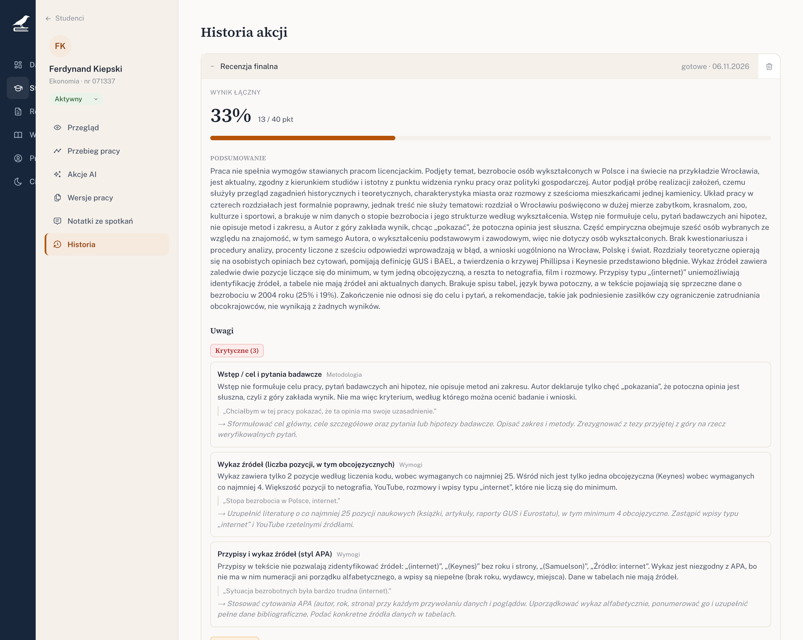
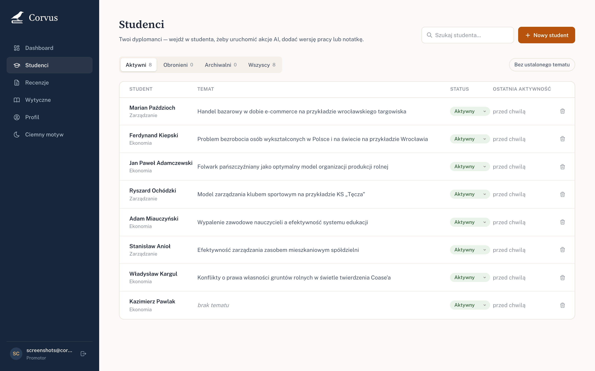
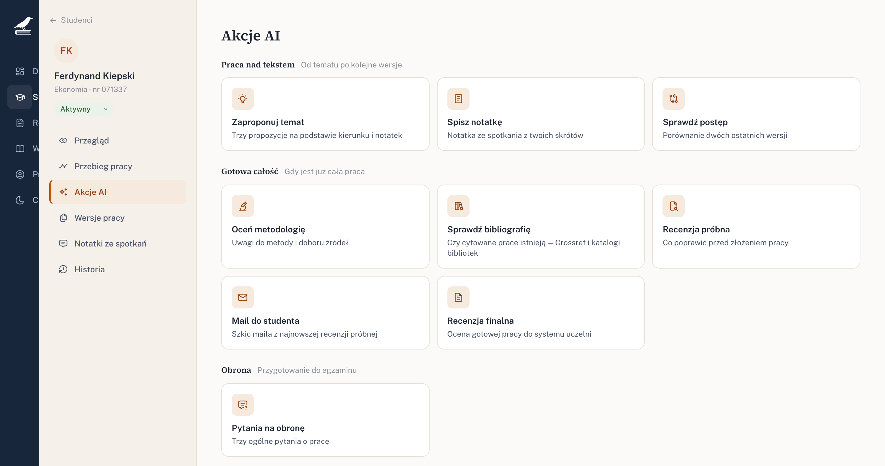
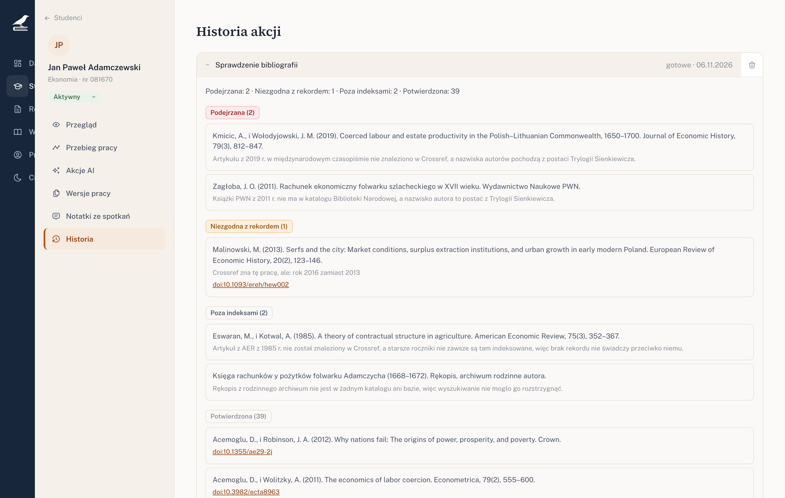
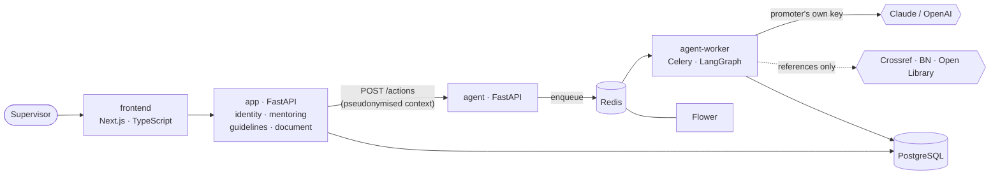
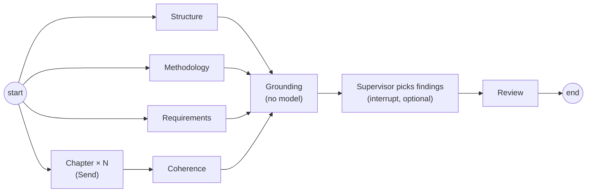

<div align="center">


# Corvus

**An AI assistant for thesis supervisors — built so its output can be trusted.**

Corvus helps a thesis supervisor (*promotor*) follow students from topic to defence:
meeting notes, chapters submitted in rounds, progress between versions, a trial review
before submission, the final review, and questions for the defence.

[](https://github.com/SlawCzech/corvus-academic/actions/workflows/ci.yml)
[](LICENSE)


[Features](#what-it-does) · [Architecture](#architecture) · [Quick start](#quick-start) ·
[Design decisions](#design-decisions) · [Evals](#evaluating-the-model) · [Docs](#documentation)

</div>

---

## Why

Pasting a thesis into a chat window gets you a fluent review that may quote a sentence
the thesis never contained, invent a missing conclusion, or praise the work in the same
breath as it lists its flaws. A supervisor who catches one such mistake stops trusting
the rest.

Corvus is the opposite bet: **predefined actions instead of open chat**, and code
wherever code can do the job better than a model. The model reads and judges; the code
counts pages and sources, checks that every quoted passage really is in the thesis,
merges duplicate findings, looks references up in Crossref and library catalogues, and
strips names before anything leaves the server. Every prompt change is measured
against theses with planted defects before it ships.

## What it does

A supervisor keeps a roster of students. For each of them Corvus stores meeting notes,
thesis versions (PDF/DOCX, with a retention policy), and chapters submitted in rounds,
all on one timeline. On top of that sit eleven AI actions:

| Action | What the supervisor gets |
|---|---|
| **Final review** (`generate_review`) | A review of the accepted version with a point score, ready to paste into the university system. Parallel analysis of structure, methodology, formal requirements and every chapter, then a coherence check (do the conclusions follow from the results?). Optionally pauses so the supervisor can pick which findings go in. |
| **Trial review** (`trial_review`) | The same analysis on the latest draft, but phrased as what to fix before submission. |
| **Mail to the student** | A draft e-mail built from the latest trial review: a list of fixes, no scores. Corvus never sends anything. |
| **Chapter feedback** (`review_fragment`) | Gentle feedback on a chapter in progress, aware of the previous round. Doesn't nag about what isn't written yet. |
| **Progress check** | Compares two versions of the thesis, with meeting notes from between them as context. |
| **Methodology** | A focused evaluation of research design, with every finding grounded in a quote. |
| **Bibliography check** | Verifies every reference against Crossref, the National Library of Poland and Open Library; an agent with search tools handles the ambiguous ones. Only bibliographic entries leave the server, never the thesis. |
| **Defence questions** | Short, general, speakable questions for the oral exam. |
| **Topic proposal** | Topic suggestions from the student's research area and aims. |
| **Meeting note** | A draft note from the supervisor's bullet points. |
| **Rubric from a regulation** | For admins: upload a university's thesis regulation, get a draft grading rubric in four sections plus numeric thresholds, check it against the original, publish. |

One-off reviews (a thesis from outside your roster) are supported too, and can be
promoted to a full student later.

### Screenshots

<p align="center">
  
  <br /><sub>Final review of a weak bachelor's thesis: overall score, summary, findings by severity — each with the exact quote it rests on.</sub>
</p>

<table>
  <tr>
    <td width="50%"></td>
    <td width="50%"></td>
  </tr>
  <tr>
    <td><sub>The roster — one row per student, topic and status.</sub></td>
    <td><sub>AI actions, grouped by stage of the thesis.</sub></td>
  </tr>
  <tr>
    <td colspan="2"></td>
  </tr>
  <tr>
    <td colspan="2"><sub>Bibliography check: two invented references caught (their authors are characters from Sienkiewicz's <i>Trilogy</i>), one with the wrong year per Crossref, two that no index can settle.</sub></td>
  </tr>
</table>

<sub>All data shown is synthetic demo data (`make seed-demo`); the UI is in Polish.</sub>

> [!NOTE]
> Corvus drafts; the supervisor decides. Every result waits for the supervisor's
> acceptance, and the review is the supervisor's text to edit. Prompts and UI are in
> Polish, built around Polish university regulations.

## Architecture

Two Python services, split along the one line that matters: fast synchronous CRUD
versus slow asynchronous LLM work ([ADR 0002](docs/adr/0002-consolidate-services-into-app-and-agent.md)).
Inside `app`, bounded contexts are separated by package and Postgres schema, and the
boundaries are enforced in CI by `import-linter`.



The final review graph, in LangGraph:



| Layer | Tech |
|---|---|
| Frontend | Next.js 16 (App Router), React 19, TypeScript strict, Vitest |
| `app` | FastAPI, SQLAlchemy (async), Alembic (one lineage per schema), JWT + bcrypt, Fernet |
| `agent` | FastAPI, LangGraph (Postgres checkpoints), Celery, structured output |
| Models | Claude or OpenAI, always on the supervisor's own key |
| Data | PostgreSQL 16, Redis |
| Ops | Docker Compose, Caddy, GitHub Actions → GHCR → VPS, Flower, Langfuse/LangSmith (optional) |
| Quality | ruff, pyright strict, pytest (≈1 100 tests), import-linter, ESLint, pre-commit, Dependabot |

## Design decisions

Every non-obvious choice has an Architecture Decision Record — 26 of them, in
[`docs/adr/`](docs/adr/). The ones that shape the product most:

- **Predefined actions, not chat** ([0005](docs/adr/0005-predefined-actions-not-open-chat.md)).
  Each action has its own graph, prompt, output schema and eval.
- **Code measures, the model judges** ([0020](docs/adr/0020-code-measures-the-model-judges.md)).
  Page counts, source counts and thresholds are computed and handed to the model as
  facts; the model decides what they mean for this kind of thesis.
- **Every finding is grounded.** A deterministic step drops any finding whose quote is
  not in the thesis text and merges duplicates from parallel branches.
- **Names stay in Corvus** ([0023](docs/adr/0023-names-stay-in-corvus.md)). Author,
  supervisor, student ID and e-mail addresses become placeholders (`[autor]`…) in every
  text before the context reaches a provider.
- **Bring your own key** ([0011](docs/adr/0011-a-key-per-provider-chosen-per-action.md),
  [0012](docs/adr/0012-seal-the-provider-key-for-the-task-queue.md),
  [0022](docs/adr/0022-every-action-runs-on-a-providers-key.md)). The server has no model
  of its own. Keys are encrypted at rest, sealed while they sit in the task queue, and
  live in a `ContextVar` only for the duration of one graph run — never in graph state.
- **Durable runs** ([0010](docs/adr/0010-graph-checkpoints-and-late-acks.md)). Every graph
  run is checkpointed in Postgres and tasks are acked late, so a worker that dies
  mid-review resumes from the last finished node.
- **Admins and supervisors are disjoint roles** ([0008](docs/adr/0008-admin-and-promoter-are-separate-roles.md)).
  The person who manages the system cannot read students' work.

## Quick start

Requirements: Docker with Compose, `make`, and an Anthropic or OpenAI API key for
running AI actions.

```bash
git clone https://github.com/SlawCzech/corvus-academic.git
cd corvus-academic
cp .env.example .env
```

Fill in `.env` — at minimum `JWT_SECRET`, `FERNET_KEY`, `ADMIN_EMAIL` and
`ADMIN_PASSWORD`. Generation commands are in the comments. Then:

```bash
docker compose -f infra/docker-compose.yml up -d --build   # migrations and the admin account run on start
make seed-guidelines                                       # load the bundled university rubrics
```

| Service | URL |
|---|---|
| Frontend | http://localhost:3000 |
| API docs (`app`) | http://localhost:8000/docs |
| Flower | http://localhost:5555 |

Log in as the admin and create a supervisor account. As the supervisor, add your API
key under **Profile**, then load the demo roster — eight synthetic theses with planted
defects, written about fictional characters from Polish film and TV:

```bash
make seed-demo PROMOTOR=supervisor@example.com
```

## Development

```bash
make help        # every target
make dev         # whole stack with hot reload (app/src, agent/src)
make front-dev   # Next.js dev server on the host instead of the container
```

Checks, as CI runs them:

```bash
cd app   && uv run ruff check . && uv run ruff format --check . && uv run lint-imports && uv run pyright src && uv run pytest -q
cd agent && uv run ruff check . && uv run ruff format --check . && uv run pyright src && uv run pytest -q
cd frontend && npm run lint && npm run typecheck && npm test
```

Pre-commit hooks (ruff, ESLint, secret detection): `uvx pre-commit install`.

## Evaluating the model

Unit tests can't tell whether a prompt change made reviews better. The
[`agent/evals/`](agent/evals/) suite runs the real action graphs on synthetic theses with
defects planted on purpose, and a judge model matches findings to an answer key:

```bash
export ANTHROPIC_API_KEY=...
make eval                    # final review: recall, false flags, duplicates
make eval-trial              # trial review advice + the mail built from it
make eval-fragments          # chapter feedback: tone and direction
make eval-rubric             # rubric drafted from a real regulation
```

The headline numbers for the final review are **recall** (planted defects named) and
**false flags** (claims that aren't true — the most expensive error). Current results on
Claude: recall 0.83–1.00, zero false flags across repeated runs. History and method:
[agent/evals/README.md](agent/evals/README.md).

## Deployment

Production runs on a single VPS: Docker Compose behind Caddy (automatic HTTPS), with
only ports 80/443 exposed. A merge to `main` runs CI, builds images to GHCR and deploys
over SSH; `deploy.sh` waits for health checks and rolls back to the previous image if
the new one doesn't come up. Database backups run daily. See
[docs/deploy.md](docs/deploy.md) and [`infra/deploy/`](infra/deploy/).

## Documentation

| | |
|---|---|
| [docs/adr/](docs/adr/) | Architecture Decision Records (English) |
| [docs/architecture.md](docs/architecture.md) | System architecture in depth (Polish) |
| [docs/specs/](docs/specs/) | Feature specs and implementation plans |
| [docs/deploy.md](docs/deploy.md) | Server setup and the deploy pipeline (Polish) |
| [docs/technical-debt.md](docs/technical-debt.md) | Known debt, kept honest |
| [agent/evals/](agent/evals/README.md) | How model quality is measured (Polish) |

## Privacy and responsible use

Corvus processes unpublished student work. Before running it with real theses:

- Thesis text goes to the AI provider the supervisor picks, under that supervisor's own
  API account and its data terms. Names and identifiers are replaced first, but the
  thesis content itself is sent.
- Tracing (LangSmith, Langfuse) records prompts. Use it with synthetic theses only.
- Check your university's rules on using AI in assessment. Corvus produces drafts; the
  grade and the review are the supervisor's responsibility.
- Whoever runs an instance holds students' data for the supervisors: the terms of service
  at `/terms` carry a data processing agreement (art. 28 GDPR), and a supervisor reaches
  no student data before accepting them. Thesis files go 14 days after the final version
  is accepted and 30 days after supervision ends
  ([ADR 0027](docs/adr/0027-corvus-is-the-promoters-processor.md)).

## How it was built

Corvus is a solo project, developed with [Claude Code](https://www.anthropic.com/claude-code)
as a pair programmer. The decision records, specs and evals in this repository are the
working scaffolding of that process, not after-the-fact documentation.

## Contributing

Issues and suggestions are welcome — see [CONTRIBUTING.md](CONTRIBUTING.md). To report a
vulnerability, follow [SECURITY.md](SECURITY.md) instead of opening an issue.

Anything else — access to the hosted instance, questions from supervisors — goes to
**corvus@saek.dev**.

## License

[MIT](LICENSE) © 2026 Sławomir Czech.

The bundled university regulation documents in `app/scripts/seed_data/` are official
documents reproduced for demonstration. The demo theses are synthetic.

If you use Corvus in research, please cite it — see [CITATION.cff](CITATION.cff).
